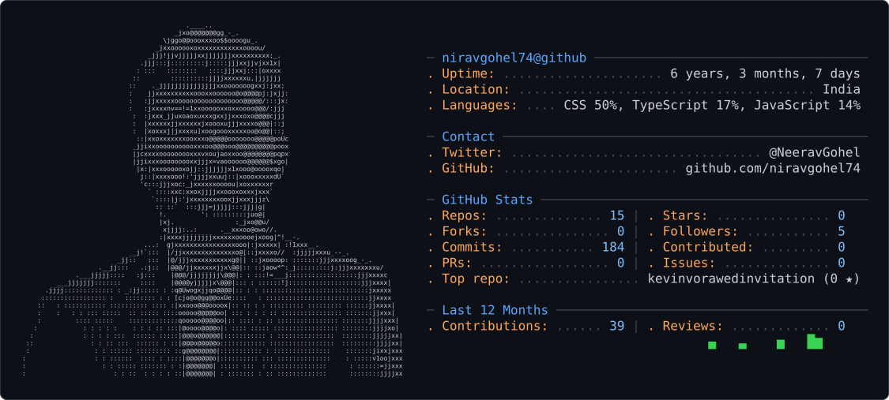

<picture>
  <source media="(prefers-color-scheme: dark)" srcset="dark_mode.svg" />
  <source media="(prefers-color-scheme: light)" srcset="light_mode.svg" />
  
</picture>

<!-- Heads up: replace every "your-github-username" below with your actual GitHub username before pushing, so the stats/streak/trophy/views widgets point at your profile instead of showing broken images. -->

 

<!-- 
 -->

---

### 🚀 About Me

- 💼 2+ years shipping production apps with **Python, Django & FastAPI**

- 🧩 Full-stack when the project calls for it — **Vue.js, Angular.js, JavaScript**

- 🤖 Currently learning **Machine Learning**, **Deep Learning**, and **Artificial Intelligence**.

- 🌱 **Exploring**

    - Machine Learning
    - Deep Learning
    - Generative AI
    - Computer Vision
    - LLM Applications
- 📫 Let's connect — links at the bottom!

---

### 💼 Featured Work

| Project | What it is |
|:---|:---|
| 🔩 **EvoParts** | B2B e-commerce platform |
| 🏭 **EvoSteel** | Manufacturing ERP system |
| 🚲 **QuadVelo** | German bicycle e-commerce platform |
| 🔌 **PCB Management System** | Workflow tool for PCB manufacturing |

---

### 🛠️ Tech Stack

**Languages & Backend**
 

**Frontend**
 

**Database & Tools**
 

**Currently Exploring**
 

---
<!-- 
### 📊 GitHub Stats

 -->

<!-- --- -->

# 💡 Fun Facts

- ☕ Coffee + Python = Productivity
- 🚀 Love building scalable backend systems
- 🤖 Learning AI one project at a time
- 🌍 Always excited to collaborate on open-source projects

---

# 🌐 Connect With Me

---

### ⭐ Thanks for visiting my profile!

*"Building scalable software today while exploring intelligent systems for tomorrow."*

